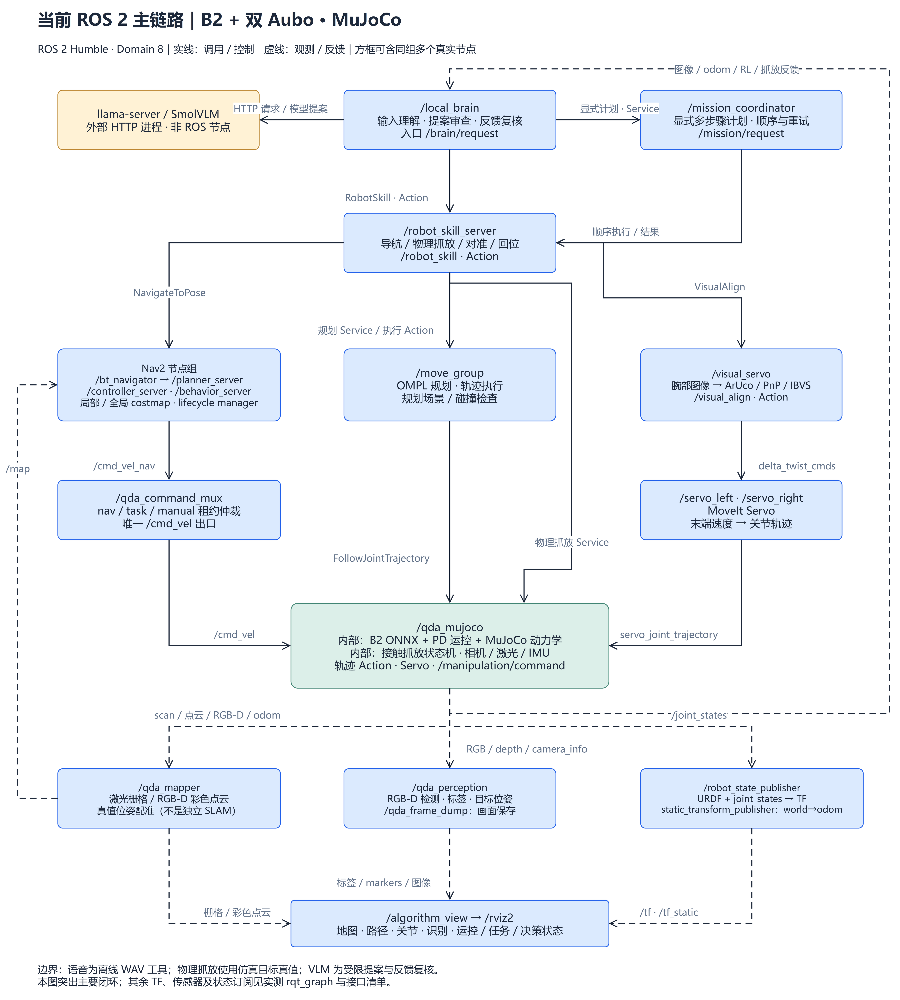
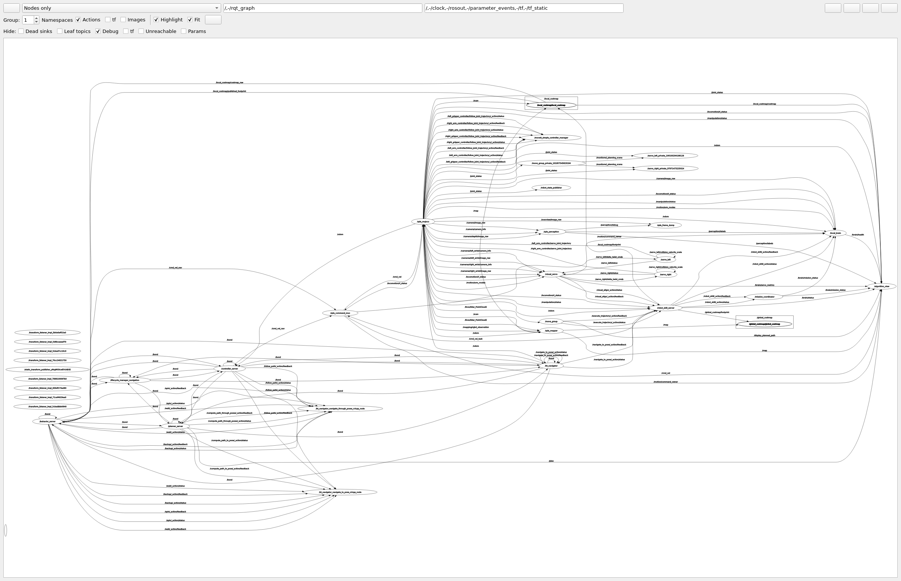

<div align="center">

# 四足 × 双臂 · 具身机器人仿真

**从看见场景，到移动、抓取与放置。**

B2 · 双 Aubo A3 · Robotiq 2F-85 · ROS 2 Humble


[效果展示](#仿真效果演示) · [开始部署](#快速开始) · [系统架构](#ros-2-节点网络) · [验证记录](#验证记录)

<a href="https://github.com/wenjw666/quadruped-dual-arm-sim/blob/main/media/readme/physical-pick-place.mp4">
  
</a>

**接触抓取 → RL 携物移动 → 目标台放置**

[▶ 观看抓放视频](media/readme/physical-pick-place.mp4) · [原速完整录像 · 122 秒](Videos/physical-pick-carry-place-validated.mp4) · [实现与验收](PHYSICAL_PICK_PLACE.md)

</div>

## 仿真效果演示

以下画面均来自实际仿真运行。**动图在页面内循环播放，点击可打开视频。** 预览经过降帧与加速，倍率仅影响回放。

<table>
<tr>
<td width="50%" align="center">
<h3>RGB-D · 彩色建图</h3>
<a href="https://github.com/wenjw666/quadruped-dual-arm-sim/blob/main/media/readme/colored-map.mp4"></a>
<p>从相机观测累积彩色点云，查看场景覆盖。</p>
<a href="media/readme/colored-map.mp4">▶ 视频</a> · <a href="Videos/colored_map_orbit.mp4">原片 · 18 秒</a> · <a href="NAVIGATION_MAPPING_DEMO.md#建图">技术记录</a>
</td>
<td width="50%" align="center">
<h3>Nav2 × RL · 绕场导航</h3>
<a href="https://github.com/wenjw666/quadruped-dual-arm-sim/blob/main/media/readme/navigation.mp4"></a>
<p>9 个目标点 · 路线约 27.18 m · 最大位置误差约 11.5 cm。</p>
<a href="media/readme/navigation.mp4">▶ 视频 · 约 9×</a> · <a href="Videos/navigation-perimeter.mp4">原片 · 223 秒</a> · <a href="NAVIGATION_MAPPING_DEMO.md#导航">技术记录</a>
</td>
</tr>
</table>

### 大脑决策 · 看清每一次调用与反馈

<div align="center">
<a href="https://github.com/wenjw666/quadruped-dual-arm-sim/blob/main/media/readme/decision-loop.mp4">

</a>

**观测与状态 → VLM 提案 → 程序校验 → 技能执行 → 结果回读**

[▶ 观看闭环视频 · 约 3×](media/readme/decision-loop.mp4) · [原片 · 79 秒](Videos/decision-loop-clean.mp4) · [输入输出与调用逻辑](DECISION_LOOP_DEMO.md)

</div>

<details>
<summary><strong>演示条件与验证边界</strong> · 展开查看真实数据、模型限制及回放说明</summary>

- **抓放：** 物体保持自由刚体，通过夹爪接触搬运，没有物体传送或虚拟焊接。首页为 5× 回放；录像使用生产物理状态机，但录像回合的路线跟踪器与完整 ROS/Nav2 脑控验收回合分开记录，见[抓放报告](PHYSICAL_PICK_PLACE.md)。
- **建图与定位：** RGB-D 来自实际仿真渲染，彩色地图配准、定位和物理抓放目标位姿使用仿真真值，不是独立 SLAM 或纯视觉抓取验收。
- **导航：** 9 个目标点和误差来自一个干净回合，不代表统计成功率。
- **大脑：** 本地 SmolVLM 提供有界提案，程序负责校验与放行；录像保留模型错误提出 `complete` 并被门控拦截的过程，不代表开放式自主任务分解。
- **版本：** v0.2.0 为 Windows + Docker + ROS 2 Humble 工程基线。RL 仍属实验性，未完成所有路线、实机和完整方案验收。

</details>

## ROS 2 节点网络

### 主链路



图中汇总主要控制、Service/Action 调用与反馈路径。RL 策略在 `/qda_mujoco` 节点内部运行；本地 VLM 通过 HTTP 提供服务，不是 ROS 节点。架构图为便于阅读省略了部分状态订阅与通用接口。

<details>
<summary><strong>展开实际 rqt_graph 与 ROS 2 网络审计</strong></summary>

### 实际 rqt_graph



这是 MuJoCo、RL、Nav2、MoveIt、视觉伺服、感知、大脑和 RViz 同时启动后的实际 ROS 2 DDS 图，不是手工绘制图。**节点和话题较多，建议打开原图或下载高清图放大查看。**

- [节点视图原截图](media/readme/rqt-nodes-screenshot.png)
- [全部节点与话题截图](media/readme/rqt-full-screenshot.png)
- [全部节点与话题高清原图（6093 × 8206）](media/readme/rqt-full-native.png)
- [节点关系高清图（9857 × 5073）](media/readme/rqt-nodes-native.png)
- [可编辑架构图](docs/diagrams/ros2-network.drawio)
- [ROS 2 网络审计与逐节点功能表](docs/ROS2_NODE_NETWORK.md)
- [37 个实测节点、152 个话题及消息采样完整清单](docs/ROS2_LIVE_INVENTORY.md)

现场审计确认 37 个节点、152 个话题；Nav2 和两套代价地图处于 active，RL 状态 ready 且无 fault。采样时机器人未执行任务，因此不能把空闲时未产生的导航命令、VLM 决策 trace 或 Servo 指标算作任务验收。全渲染和 RViz 同时运行时，实测仿真速度低于实时。

</details>

## 功能范围

<details>
<summary><strong>查看各模块实现与当前限制</strong> · 运控 / 感知 / 导航 / 操作 / 大脑 / 语音</summary>

| 模块 | 当前实现 | 已知边界 |
|---|---|---|
| 机器人与场景 | B2 + 双 Aubo A3 + Robotiq 2F-85；扩展工厂场景；MuJoCo 主后端，Gazebo 保留对照 | Gazebo 与 MuJoCo 不代表所有功能均已达到同等验证程度 |
| 四足运动 | MuJoCo 内部 ONNX 策略 + PD 动力学控制，`/cmd_vel` 接入 Nav2/技能速度 | 实验性策略；仿真当前绑定使用真值状态；没有载荷适配策略重训结论 |
| 建图 | 激光栅格和真实渲染 RGB-D 彩色点云 | 当前用仿真真值位姿配准，不是独立 SLAM 定位验收 |
| 导航 | Nav2 行为树、SmacPlanner2D、MPPI、代价地图、速度仲裁 | 定位来源仍是仿真 `/odom`；复杂路线尚无统计成功率 |
| 感知与图像 | MuJoCo RGB-D 相机、颜色/几何检测、异步 YOLO 标签、帧保存 | 物理抓放主链目前不使用感知位姿作为唯一目标位置来源 |
| 双臂与抓放 | MoveIt 规划/轨迹、互斥控制租约、物理夹爪接触状态机、失败保持策略 | 已验收集中于左臂、单立方体和南侧路线；不是任意物体/双臂通用抓取 |
| 视觉伺服 | 腕部相机、ArUco/PnP、KLT 跟踪与 IBVS、MoveIt Servo | 需要标定目标，不等于无标记语义视觉抓取 |
| 大脑与任务编排 | 本地 SmolVLM、反馈快照、候选提案校验、技能 Action、多步骤任务协调 | 有界辅助决策，不是任意自然语言任务自主分解；模型服务是独立 HTTP 进程 |
| 语音 | 离线 WAV/Vosk 入口 | 无常驻麦克风、唤醒词、TTS 或小智云端服务 |
| 可视化 | `/algorithm_view`、RViz 状态面板、地图/点云/路径/图像 | 头less Docker 中 RViz 可在虚拟显示器运行，不一定弹出 Windows 桌面窗口 |

</details>

## 快速开始

### Docker 镜像下载

提供从已配置开发容器保存的 **Linux amd64 环境快照**，通过 `docker commit` + `docker save` 生成，使用 `docker load` 恢复。

| 项目 | 内容 |
|---|---|
| 百度网盘 | [下载仿真镜像](https://pan.baidu.com/s/1HFdQVUul4sOBxReeAEjAlQ?pwd=tmxv) · 提取码：`tmxv` |
| 归档文件 | `qda-ros-humble-v0.2.0-container.tar`（2,280,816,128 字节，约 2.12 GiB） |
| 校验文件 | [下载 SHA-256 校验文件](qda-ros-humble-v0.2.0-container.tar.sha256) |
| 镜像标签 | `qda-ros:humble-v0.2.0-container` |
| 镜像 ID | `sha256:673a0aa2f82918926c6dc5dcaad23dae2d9d4b9d47c6b0507b47d7881ce917a0` |

归档 SHA-256：

```text
10a6860cf369d621779c9277859912c36c722d510a1633b7b48cf8dfb26fe7e9
```

**tar 不包含挂载到 `/ws` 的源码、编译结果和运行资产，也不保存正在执行的任务或进程内存。** 请同时获取本仓库、Git LFS 资产，并按 [Release 恢复说明](docs/RELEASE_V0.2.0.md)恢复匹配的策略、网格和本地模型，完成编译；只有 tar 无法独立运行完整工程。

### Windows + Docker Desktop

已配置环境的镜像导入、更新与验证见 [Docker 部署说明](docs/DOCKER_DEPLOYMENT.md)。Windows 工具统一收纳在 `scripts/windows/`，推荐使用 `scripts/windows/qda.ps1 help` 查看入口；完整命令表见 [Windows 工具说明](scripts/windows/README.md)。镜像 tar 保存容器环境，`/ws` 中的项目代码与运行资产须另行提供。

当前开发入口约定容器名 `qda-dev`、工作区挂载点 `/ws`，并使用 X11 显示服务。首次准备环境、恢复版本化运行资产和模型的完整步骤见[安装与恢复说明](docs/RELEASE_V0.2.0.md)。已有容器和工作区时，可按需启动：

Docker Desktop 使用 Linux 容器 / WSL2；桌面显示需要 Windows X11 服务，例如 VcXsrv，供容器连接 `host.docker.internal:0.0`。当前 Compose 请求 NVIDIA GPU，需相应容器支持或按硬件调整配置。下载归档后，将 tar 与 `.sha256` 放在仓库根目录：

```powershell
# 校验并导入镜像
.\scripts\windows\qda.ps1 image -Mode load
# 使用快照镜像启动容器，当前仓库挂载为 /ws
.\scripts\windows\qda.ps1 image -Mode start
# 完成资产恢复和编译后，启动本地模型、主场景和桌面窗口
.\scripts\windows\qda.ps1 brain -WithSimulation
```

`image -Mode start` 可能重建已有同名容器，应先保存旧容器尚未归档的环境修改。后台启动命令返回不代表所有节点已就绪。以下是其他按需入口，启动前应停止已有的同一后端：

```powershell
# MuJoCo 主场景
.\scripts\windows\run_sim.ps1 -Backend mujoco -Scenario auto -Background

# V2 大脑与视觉伺服服务
.\scripts\windows\start_brain.ps1 -WithSimulation -ServoFixture -NoPhysicsGui

# Gazebo 对照后端
.\scripts\windows\run_sim.ps1 -Backend gazebo -Scenario auto -Background

# 停止仿真
.\scripts\windows\stop_sim.ps1
```

不要同时启动多个 ROS Domain 相同且控制同一个仿真机器人的 launch。抓放和导航等任务入口及参数见[扩展场景演示](EXPANDED_DEMO.md)、[建图与导航](NAVIGATION_MAPPING_DEMO.md)和[物理抓放](PHYSICAL_PICK_PLACE.md)。

### 资产与部署提示

- 克隆后按需安装 Git LFS 并执行 `git lfs pull`，获取仓库已跟踪的大型模型资产。
- V2 Release 运行包包含匹配的 ONNX、模型元数据与网格依赖；按 [Release 文档](docs/RELEASE_V0.2.0.md)校验 SHA-256 后恢复。
- 已验证快照镜像配合现有完整工作区运行；从 Dockerfile 全新构建、干净克隆恢复资产的完整一键部署尚未验收。
- `build/`、`install/`、日志、运行数据库、任务报告和原始传感器数据属于本地生成内容，不随源码仓库分发。

<details>
<summary><strong>镜像实测结果与后续版本更新方法</strong></summary>

### 镜像复核结果（2026-10-28）

在本机 Windows Docker Desktop 实际导入上述 tar，创建独立容器并挂载完整工作区后，已完成：

- 场景资产和依赖检查、ROS 2 网络采样、本地模型服务健康检查。
- MuJoCo 原生窗口和 RViz 实际显示，RL 运控状态 ready 且无 fault。
- 生产大脑 API 下的真实接触抓取 → RL 携物导航 → 放置 → 松爪退臂 → 台面稳定检查，单轮返回 `SUCCEEDED`，最大滑移 **7.62 mm**。

验证期间修复了四足俯仰时地面雷达回波被误标为障碍的问题，部署需配套本轮更新后的代码。完整取放回合关闭图像渲染；有图像与建图的启动检查另行完成，尚未证明全部模块同时满负载运行或多轮稳定成功。此前的滑落和保护终止也保留在验证记录中。Ubuntu、ARM64 与实机本轮未验证。详见 [部署与复核记录](docs/DOCKER_DEPLOYMENT.md)。

### 后续开发如何更新

| 改动 | 更新方式 |
|---|---|
| Python、参数和 launch | 更新挂载源码并重启；按安装方式决定是否重新编译，通常无需重打镜像 |
| C++、消息接口和 ROS 包结构 | 在容器 `/ws` 内重新 `colcon build` 后重启 |
| 策略、网格和模型权重 | 同步对应资产及校验值，重新执行资产检查 |
| apt/pip 或系统依赖 | 同步 Dockerfile 和依赖清单，验证后保存新版本镜像与 tar |

镜像更新使用新标签保留上一版：

```powershell
.\scripts\windows\qda.ps1 stop -Backend all
.\scripts\windows\qda.ps1 image -Mode snapshot -Image qda-ros:humble-v0.2.1-container
.\scripts\windows\qda.ps1 image -Mode save -Image qda-ros:humble-v0.2.1-container -Archive qda-ros-humble-v0.2.1-container.tar
```

导出会生成 SHA-256 文件并拒绝覆盖已有归档。镜像 tar 通过网盘分发，不提交到 Git；配套源码、资产版本和验证结果应同步记录。Ubuntu Docker Engine 的恢复命令及显示配置见 [Ubuntu 迁移说明](docs/DOCKER_DEPLOYMENT.md#ubuntu-迁移)。

</details>

## 工程结构

```text
src/
  qda_bringup/       launch、场景装配、Nav2、RViz、底盘指令仲裁
  qda_description/   B2 机器人描述、传感器、夹爪与控制器配置
  qda_mujoco/        MuJoCo 动力学、RL/PD、传感器和物理抓放状态机
  qda_gazebo_plugins/ Gazebo 对照路径中的仿真插件
  qda_locomotion/    B2 策略契约、ONNX/PPO 工具与运控适配
  qda_perception/    RGB-D 检测、地图融合与图像保存
  qda_brain/         大脑请求、技能 Action、任务协调与视觉伺服
  qda_moveit_config/ 双臂规划组与 MoveIt 配置
  qda_interfaces/    ROS 2 自定义 Action/Service 消息
```

本地代码入口与节点关系详见[整体架构说明](docs/CODE_ARCHITECTURE.md)；ROS 2 节点、Topic、Service、Action 和现场状态详见[节点网络审计](docs/ROS2_NODE_NETWORK.md)。

## 验证记录

- [v0.2.0 工程基线与恢复验证](docs/RELEASE_V0.2.0.md)
- [决策反馈闭环记录](DECISION_LOOP_DEMO.md)
- [建图与导航演示记录](NAVIGATION_MAPPING_DEMO.md)
- [物理抓放实现与验收](PHYSICAL_PICK_PLACE.md)
- [双仿真后端说明](DUAL_BACKEND.md)
- [模型精修记录](MODEL_REFINEMENT.md)
- [第三方代码与来源说明](docs/THIRD_PARTY_SNAPSHOT.md)

视频预览和本轮节点图为便于仓库首页展示而加入的媒体文件。演示片段是特定仿真回合，不代表统计成功率或实机表现。运行时 ROS 抓图、日志及逐帧数据未放入 GitHub。

## 许可证与第三方声明

仓库目前没有为所有项目文件授予统一许可证；公开可见不等于自动获得再发布或商用授权。第三方源码、模型与素材仍遵循各自原始许可证和声明。来源与版本记录见[第三方快照清单](docs/THIRD_PARTY_SNAPSHOT.md)。
