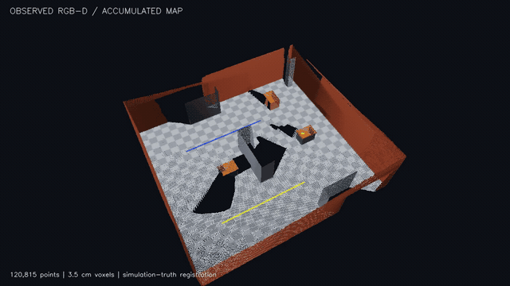
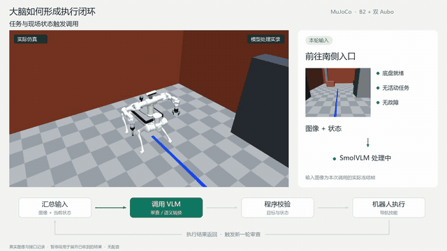
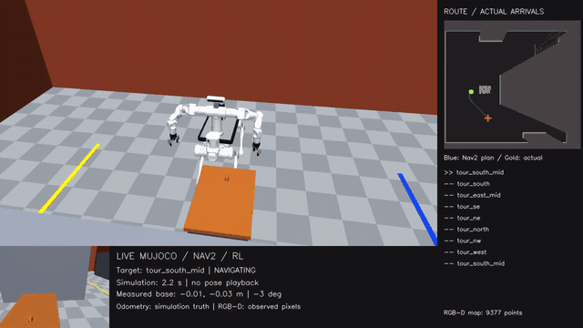
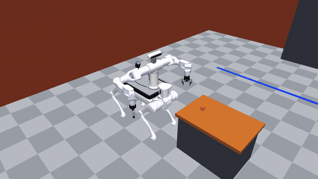

# 四足双臂机器人仿真 | ROS 2 · MuJoCo · Gazebo

**版本：v0.2.0 仿真工程基线** · ROS 2 Humble · MuJoCo 主后端 · Gazebo 对照后端

本仓库维护宇树 B2 四足底盘、双 Aubo A3 机械臂、Robotiq 2F-85 夹爪和相机组成的仿真工程，覆盖 RL 运控、建图与导航、RGB-D 感知、双臂控制、物理抓放、视觉伺服以及受约束的大脑决策闭环。演示素材来自真实仿真运行；页面内动画为加速后的预览，完整原始录像可下载查看。

> **验证边界：** v0.2.0 是当前 Windows + Docker + ROS 2 Humble 环境的工程基线，不表示所有算法、路线、实机或完整方案均已验收。RL 仍属实验性；定位、彩色地图配准和物理抓放目标位姿使用仿真真值。视频中的大脑闭环是有界提案审查，不代表开放式自主任务分解。

## 仿真效果演示

下列预览经过降分辨率、降帧率和加速处理以便在 README 中快速浏览。点击动图可播放对应的压缩 MP4；每节另附原始录像下载链接。动画中的速度倍率只改变回放展示，不改变任务结果或仿真验证数据。

### RGB-D 彩色建图

[](media/readme/colored-map.mp4)

[播放压缩预览](media/readme/colored-map.mp4) · [下载原始建图环绕视频（18 秒）](Videos/colored_map_orbit.mp4) · [建图数据、覆盖审计与真值配准说明](NAVIGATION_MAPPING_DEMO.md#建图)

### 大脑决策反馈闭环

[](media/readme/decision-loop.mp4)

[播放压缩预览](media/readme/decision-loop.mp4) · [下载原始决策闭环视频（78.9 秒，预览约 3×）](Videos/decision-loop-clean.mp4) · [模块输入输出、决策过程与边界](DECISION_LOOP_DEMO.md)

本例会展示模型原始输出、语义转换、程序校验、技能下发与执行结果。原始 VLM 曾给出错误的 `complete` 提案，程序门控阻止了错误放行；演示如实保留这一过程。

### Nav2 绕场导航

[](media/readme/navigation.mp4)

[播放压缩预览](media/readme/navigation.mp4) · [下载原始导航视频（222.9 秒，预览约 9×）](Videos/navigation-perimeter.mp4) · [9 个目标点、路线与测量结果](NAVIGATION_MAPPING_DEMO.md#导航)

干净回合到达 9 个目标，实测路线约 27.18 m，最大位置误差约 11.5 cm。回放已加速，完整路线、误差与限制以演示记录为准。

### 真实接触抓取、搬运与放置

[](media/readme/physical-pick-place.mp4)

[播放压缩预览](media/readme/physical-pick-place.mp4) · [下载原始抓放视频（122.4 秒，预览约 5×）](Videos/physical-pick-carry-place-validated.mp4) · [物理状态机、失败保护与验收数据](PHYSICAL_PICK_PLACE.md)

物体在仿真中保持自由刚体并通过夹爪接触搬运，不使用物体传送或虚拟焊接。该录像由生产物理抓放状态机运行；录像采集回合的路线跟踪器与完整 ROS/Nav2 脑控验收回合分开记录，详见抓放报告。

## ROS 2 节点网络

### 主链路


图中汇总主要控制、Service/Action 调用与反馈路径。RL 策略在 `/qda_mujoco` 节点内部运行；本地 VLM 通过 HTTP 提供服务，不是 ROS 节点。架构图为便于阅读省略了部分状态订阅与通用接口。

### 实际 rqt_graph


这是 MuJoCo、RL、Nav2、MoveIt、视觉伺服、感知、大脑和 RViz 同时启动后的实际 ROS 2 DDS 图，不是手工绘制图。**节点和话题较多，建议打开原图或下载高清图放大查看。**

- [节点视图原截图](media/readme/rqt-nodes-screenshot.png)
- [全部节点与话题截图](media/readme/rqt-full-screenshot.png)
- [全部节点与话题高清原图（6093 × 8206）](media/readme/rqt-full-native.png)
- [节点关系高清图（9857 × 5073）](media/readme/rqt-nodes-native.png)
- [可编辑架构图](docs/diagrams/ros2-network.drawio)
- [ROS 2 网络审计与逐节点功能表](docs/ROS2_NODE_NETWORK.md)
- [37 个实测节点、152 个话题及消息采样完整清单](docs/ROS2_LIVE_INVENTORY.md)

现场审计确认 37 个节点、152 个话题；Nav2 和两套代价地图处于 active，RL 状态 ready 且无 fault。采样时机器人未执行任务，因此不能把空闲时未产生的导航命令、VLM 决策 trace 或 Servo 指标算作任务验收。全渲染和 RViz 同时运行时，实测仿真速度低于实时。

## 功能范围

| 模块 | 当前实现 | 已知边界 |
|---|---|---|
| 机器人与场景 | B2 + 双 Aubo A3 + Robotiq 2F-85；扩展工厂场景；MuJoCo 主后端，Gazebo 保留对照 | Gazebo 与 MuJoCo 不代表所有功能均已达到同等验证程度 |
| 四足运动 | MuJoCo 内部 ONNX 策略 + PD 动力学控制，`/cmd_vel` 接入 Nav2/技能速度 | 实验性策略；仿真当前绑定使用真值状态；没有载荷适配策略重训结论 |
| 建图 | 激光栅格和真实渲染 RGB-D 彩色点云 | 当前用仿真真值位姿配准，不是独立 SLAM 定位验收 |
| 导航 | Nav2 行为树、SmacPlanner2D、MPPI、代价地图、速度仲裁 | 定位来源仍是仿真 `/odom`；复杂路线尚无统计成功率 |
| 感知与图像 | MuJoCo RGB-D 相机、颜色/几何检测、异步 YOLO 标签、帧保存 | 物理抓放主链目前不使用感知位姿作为唯一目标位置来源 |
| 双臂与抓放 | MoveIt 规划/轨迹、互斥控制租约、物理夹爪接触状态机、失败保持策略 | 已验收集中于左臂、单立方体和南侧路线；不是任意物体/双臂通用抓取 |
| 视觉伺服 | 腕部相机、ArUco/PnP、KLT 跟踪与 IBVS、MoveIt Servo | 需要标定目标，不等于无标记语义视觉抓取 |
| 大脑与任务编排 | 本地 SmolVLM、反馈快照、候选提案校验、技能 Action、多步骤任务协调 | 有界辅助决策，不是任意自然语言任务自主分解；模型服务是独立 HTTP 进程 |
| 语音 | 离线 WAV/Vosk 入口 | 无常驻麦克风、唤醒词、TTS 或小智云端服务 |
| 可视化 | `/algorithm_view`、RViz 状态面板、地图/点云/路径/图像 | 头less Docker 中 RViz 可在虚拟显示器运行，不一定弹出 Windows 桌面窗口 |

## 快速开始

### Windows + Docker Desktop

当前开发入口约定容器名 `qda-dev`、工作区挂载点 `/ws`，并使用 X11 显示服务。首次准备环境、恢复版本化运行资产和模型的完整步骤见[安装与恢复说明](docs/RELEASE_V0.2.0.md)。已有容器和工作区时，可按需启动：

```powershell
# MuJoCo 主场景
.\run_sim.ps1 -Backend mujoco -Scenario auto -Background

# V2 大脑与视觉伺服服务
.\start_brain.ps1 -WithSimulation -ServoFixture -NoPhysicsGui

# Gazebo 对照后端
.\run_sim.ps1 -Backend gazebo -Scenario auto -Background

# 停止仿真
.\stop_sim.ps1
```

不要同时启动多个 ROS Domain 相同且控制同一个仿真机器人的 launch。抓放和导航等任务入口及参数见[扩展场景演示](EXPANDED_DEMO.md)、[建图与导航](NAVIGATION_MAPPING_DEMO.md)和[物理抓放](PHYSICAL_PICK_PLACE.md)。

### 资产与部署提示

- 克隆后按需安装 Git LFS 并执行 `git lfs pull`，获取仓库已跟踪的大型模型资产。
- V2 Release 运行包包含匹配的 ONNX、模型元数据与网格依赖；按 [Release 文档](docs/RELEASE_V0.2.0.md)校验 SHA-256 后恢复。
- 全新 Docker 镜像尚未完成从零到整套仿真可运行的一键部署验收；文档会明确列出已验证与未验证步骤。
- `build/`、`install/`、日志、运行数据库、任务报告和原始传感器数据属于本地生成内容，不随源码仓库分发。

## 工程结构

```text
src/
  qda_bringup/       launch、场景装配、Nav2、RViz、底盘指令仲裁
  qda_description/   B2 机器人描述、传感器、夹爪与控制器配置
  qda_mujoco/        MuJoCo 动力学、RL/PD、传感器和物理抓放状态机
  qda_gazebo_plugins/ Gazebo 对照路径中的仿真插件
  qda_locomotion/    B2 策略契约、ONNX/PPO 工具与运控适配
  qda_perception/    RGB-D 检测、地图融合与图像保存
  qda_brain/         大脑请求、技能 Action、任务协调与视觉伺服
  qda_moveit_config/ 双臂规划组与 MoveIt 配置
  qda_interfaces/    ROS 2 自定义 Action/Service 消息
```

本地代码入口与节点关系详见[整体架构说明](docs/CODE_ARCHITECTURE.md)；ROS 2 节点、Topic、Service、Action 和现场状态详见[节点网络审计](docs/ROS2_NODE_NETWORK.md)。

## 验证记录

- [v0.2.0 工程基线与恢复验证](docs/RELEASE_V0.2.0.md)
- [决策反馈闭环记录](DECISION_LOOP_DEMO.md)
- [建图与导航演示记录](NAVIGATION_MAPPING_DEMO.md)
- [物理抓放实现与验收](PHYSICAL_PICK_PLACE.md)
- [双仿真后端说明](DUAL_BACKEND.md)
- [模型精修记录](MODEL_REFINEMENT.md)
- [第三方代码与来源说明](docs/THIRD_PARTY_SNAPSHOT.md)

视频预览和本轮节点图为便于仓库首页展示而加入的媒体文件。演示片段是特定仿真回合，不代表统计成功率或实机表现。运行时 ROS 抓图、日志及逐帧数据未放入 GitHub。

## 许可证与第三方声明

仓库目前没有为所有项目文件授予统一许可证；公开可见不等于自动获得再发布或商用授权。第三方源码、模型与素材仍遵循各自原始许可证和声明。来源与版本记录见[第三方快照清单](docs/THIRD_PARTY_SNAPSHOT.md)。
