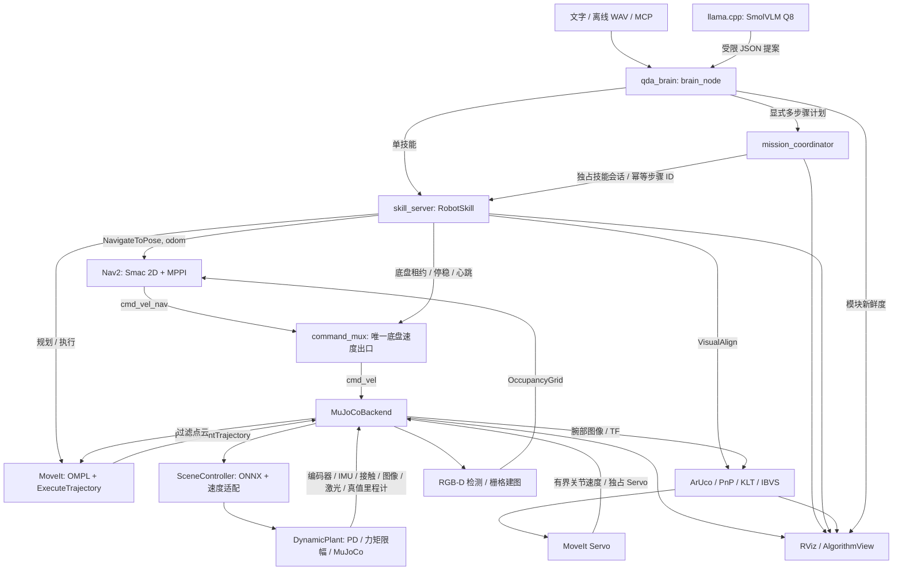

# 四足双臂仿真：当前代码结构与模块关系

2026-10-27 补充：[ROS 2 节点网络审计、逐节点功能表与现场 rqt_graph](ROS2_NODE_NETWORK.md) 给出当前接入状态。物理抓放主链已开放并有左臂/南侧路线验收；目标位置仍来自仿真真值，不能等同于通用视觉抓取。

更新：2026-10-26。工作区 `D:\20261022ubunturos_win` 挂载到 Docker 容器 `qda-dev:/ws`；ROS 2 Humble。主路径为 MuJoCo 自由基座动力学 + 实验性 B2 RL + Nav2 + MoveIt + 本地语义入口。Gazebo 保留 V1 对照路径。

V2 发布补充：[v0.2.0 发布与恢复说明](RELEASE_V0.2.0.md)。运行资产通过独立校验包保存；RViz 状态改为 `/viz/status_image` 图像面板，完整文本通过 `/viz/status_text` 保留，避免长段世界文字遮挡场景。`media/product-demo/` 是与 ROS 构建隔离的视频制作工程；实际视频等待用户确认后再进入 README。

## 1. 运行关系



两条执行链的用途不同：单技能适合调试；多步骤计划负责整段任务的顺序、停止条件和结果留存。语言模型输出不会直接接到关节或速度控制器。图中 `SceneController` 运行在 MuJoCo 节点进程内部，RL 不是额外启动一个底盘命令发布节点。

## 2. 自研包的职责

| 包 | 关键文件 | 职责与上下游 |
|---|---|---|
| `qda_brain` | `brain_node.py`, `contracts.py`, `model_client.py`, `voice.py`, `mcp_server.py` | 接收输入、白名单语义、场景/目标登记与版本、模型调用、WAV 识别、MCP。把语义变成经校验的技能或计划 |
| `qda_brain` | `mission.py`, `mission_node.py` | 一次校验整份 1–12 步计划；技能会话排他；串行调用 RobotSkill；失败停止、取消确认、重放与 SQLite 进度 |
| `qda_brain` | `skill_server.py` | 处理导航、回位、视觉对准、查询、暂停；底盘停稳、租约心跳、调用 Nav2/MoveIt/VisualAlign；记录每个技能结果 |
| `qda_brain` | `feature_tracker.py`, `ibvs.py`, `visual_servo.py` | ArUco ID、四角 KLT 过渡、PnP 深度、图像交互矩阵、TF 速度转换、Servo 启停与腕部控制权 |
| `qda_bringup` | `launch/pick_place.launch.py` | 生成/装配机器人和场景，选择后端/运动模式，配置 MoveIt/Nav2，启动完整 ROS 图 |
| `qda_bringup` | `command_mux.py`, `control_lease.py` | 唯一 `/cmd_vel` 出口。处理 manual/task/nav 输入、优先级、TTL、故障/状态/时钟看门狗、技能底盘租约 |
| `qda_bringup` | `arms.py`, `refined_assembly.py`, `world_sdf.py`, `visualization_node.py` | 注入双 Aubo、精修装配、生成场景、显示实测轨迹/接触/任务/算法状态 |
| `qda_description` | `urdf/qda_robot.urdf.xacro`, `meshes/`, `config/ros2_controllers.yaml` | 四足、立柱、相机、夹爪及 Gazebo 控制器描述；Aubo 原始几何由 bringup 注入 |
| `qda_kinematics` | `assembly.py`, `scene.py`, `kinematics.py` | 共用安装位姿、地图/目标/路线、关节限位、正逆运动学、回位/携带/Servo 准备姿态 |
| `qda_mujoco` | `model.py`, `dynamics.py` | URDF/SDF→MJCF；自由基座、接触与执行器；DynamicPlant 推进真实物理、PD、速度参考、限力矩 |
| `qda_mujoco` | `node.py`, `scene_control.py`, `cameras.py`, `servo_fixture.py` | ROS 传感器/控制器适配，快照渲染在控制锁外，ONNX 与场景绑定，模型物理签名检查，四相机，独立光学校准板 |
| `qda_locomotion` | `upstream_b2.py`, `transfer_env.py`, `onnx_policy.py`, `velocity_adapter.py` | 开源 B2 策略契约、45 维观测适配、ONNX 推理、指令响应校准和足端接触速度反馈 |
| `qda_locomotion` | `rl_env.py`, `train_ppo.py`, `transfer_ppo.py`, `rl_bench_node.py`, `locomotion_node.py` | 训练/移植/独立 ROS 台架，以及 V1 规定步态入口；不要与主场景的 SceneController 同时向同一底盘驱动 |
| `qda_perception` | `detector_node.py`, `mapper_node.py`, `frame_dump.py` | RGB-D 颜色几何检测、异步 YOLO 标签、激光/点云栅格、LIVO 对齐辅助、渲染帧保存 |
| `qda_moveit_config` | `config/qda_robot.srdf` | 手臂规划组、末端、允许碰撞配置。动态模式补浮动虚拟关节；规划/Servo 配置由 launch 注入 |
| `qda_interfaces` | `action/`, `srv/` | 跨节点协议：RobotSkill、VisualAlign、PickPlace、BrainRequest、Attach/Detach |
| `qda_task` | `pick_place_node.py`, `decision.py`, `quad_nav*.py`, `run_metrics.py` | V1 抓放演示和指标；V2 PickPlace 决策守卫的纯逻辑实现。完整物理抓放 Action 驱动尚未接入主技能服务器 |
| `qda_gazebo_plugins` | `src/grasp_plugin.cpp` | Gazebo V1 虚拟附着插件；不代表物理夹持验证 |

## 3. 关键接口和状态归属

| 接口 | 发布/服务端 | 使用者 | 语义 |
|---|---|---|---|
| `/brain/request` · BrainRequest | brain_node | CLI / MCP | interpret、submit、status、pause/cancel、mission_submit/status/cancel |
| `/mission/request` · BrainRequest | mission_coordinator | brain_node | 有界计划提交/查询/取消；提交响应仅表示接收，完成需查询终态 |
| `/robot_skill` · RobotSkill Action | skill_server | brain_node / mission | 包含 task_id、skill、object_id、target_id、arm、scene_version |
| `/skills/query` · BrainRequest | skill_server | brain / mission | 技能状态、取消、技能会话 acquire/renew/release |
| `/motion/lease` · BrainRequest | command_mux | skill_server | acquire、mode(hold/nav)、renew、release、reset；令牌只用于所有权校验 |
| `/motion/hold` · SetBool | command_mux | 人工/旧版辅助入口 | 可要求保持；活动或已过期租约期间不能由普通 False 绕过恢复 |
| `/cmd_vel_nav/task/manual` → `/cmd_vel` | 多输入 → command_mux | MuJoCoBackend | 无租约时 manual > task > nav；导航租约只接受 nav；hold 模式全零 |
| `/navigate_to_pose` | Nav2 | skill_server | 与当前 costmap 一致使用 odom；以后引入真实定位时要一并更改目标登记和导航 frame |
| `/plan_kinematic_path`, `/execute_trajectory` | MoveIt move_group | skill_server | 规划与执行物理双臂轨迹 |
| `/{left,right}_arm_controller/follow_joint_trajectory` | MuJoCoBackend | MoveIt | 轨迹控制；与同侧 Servo 租约互斥 |
| `/visual_align` · VisualAlign | visual_servo | skill_server | 对准指定标定板；末端条件为四帧检测误差 <1.5 px |
| `/{side}_arm_controller/servo_mode`, `servo_joint_trajectory` | MuJoCoBackend | visual_servo / MoveIt Servo | 控制权切换，有界关节速度按物理 dt 积分，再经 PD 与力矩限幅 |
| `/monitored_planning_scene` | move_group | 左右 Servo | 共享 OctoMap；两侧继续执行碰撞和奇异性保护 |
| `/brain/status`, `/brain/mission_status`, `/brain/health`, `/brain/servo_metrics` | brain/mission/skills/servo | RViz、测试、诊断 | 技能、步骤进度、模块新鲜度、视觉误差。消息新鲜不等于算法结果正确 |

`tasks.sqlite` 和 `missions.sqlite` 分别保存单技能与计划。内存黑板保存实时传感器/控制状态；SQLite 保存执行事实。重复 ID + 相同参数读取旧结果；重复 ID + 不同参数拒绝。进程重启将未完成记录标为 INTERRUPTED，当前恢复方式仍为停止整套 launch、检查现场后重新提交新任务。

### TF、模型与关节关系

- `world → odom` 为 launch 发布的恒等静态变换；`odom → base_link` 来自 MuJoCo 真值位姿。
- `robot_state_publisher` 接收同一 URDF 与 `/joint_states`，生成四足、立柱、双臂与夹爪的连杆树。MoveIt 和 RViz 使用这棵树。
- C0 的辅助光学 TF 挂在 `base_link`，左右腕部辅助光学 TF 挂在 `left_link7/right_link7`；控制速度通过完整 TF 转到对应夹爪参考点，而非只旋转相机轴。
- 当前代码每臂为七个活动关节，沿用已确认的组合模型；不能据 A3 网格目录名推断其已经等价于某台六轴实物臂。
- RL 只输出十二个腿关节动作；手臂与夹爪由独立的上肢位置/速度参考控制，经同一个 DynamicPlant 施加有限力矩。Servo 不绕过物理直接写关节位姿。
- 各相机外参是仿真安装参数；后续硬件部署需要实际标定，不能直接当作测量值。

## 4. 一段任务如何协同

1. 输入经受限语法或 SmolVLM 形成提案；模型提案要与本地语义校验一致才可从 CLI 执行。多步骤计划由显式 JSON 提交，整份先校验；物理抓放已通过技能服务器接入，仍需满足后端状态、控制权及参数门控。
2. Mission 获得技能会话。任务 ID 派生出固定步骤 ID，防止重试重复运动；外部单技能不能插入计划中间。
3. 导航技能取得底盘租约并设置 nav 模式，仅允许 Nav2 速度经过仲裁；规划目标 frame 与当前 odom 导航框架一致。
4. 到点后转 hold，等待五份新状态且覆盖至少 0.5 s 仿真稳定窗口。机械臂技能持有 hold 租约，人工/旧任务速度不能让底盘同时运动。
5. MoveIt 将指定臂规划到准备姿态。视觉阶段切换该臂到 Servo；相机四角与深度形成 IBVS 速度，转换到夹爪参考点，再通过 MoveIt Servo 和物理关节控制。
6. ArUco 短时失检可用最多两帧、最长 0.45 s 仿真时间的 KLT；前后向误差、光度残差、位移、凸四边形与 PnP 重投影都需通过。KLT 帧不能累计成功判据。
7. 视觉控制者用独立令牌心跳维持同侧 Servo 所有权，电机命令另有 0.35 s 仿真 / 1 s 墙钟有效期。成功后释放同侧 Servo/底盘租约，确认后 Mission 才提交下一步。失败或取消不再继续后续步骤；取消须等下游 Action 终态。停机/释放未确认时隔离该执行器并保留 hold，须整套重启检查。

租约与心跳使用 steady/wall clock，图像/关节命令同时检查仿真时间。这样暂停仿真或节点卡死时，过期命令不会因为仿真时钟停止而长期有效。底盘状态或时钟超过 5 s 墙钟不更新时仲裁归零；底盘租约 3 s、技能会话 5 s，均需续约。

## 5. 目录和依赖

```text
run_sim.ps1 / stop_sim.ps1       Windows 仿真启停
start_brain.ps1                 本地模型就绪检查与可选整套启动
run_v2_training.ps1             隔离训练入口
run_v2_rl_bench.ps1             独立运控台架
src/qda_*/                     上述自研 ROS 包
src/aubo_description/ ...      上游模型/驱动/ROS 依赖源码快照
docker/                        容器、DDS、基础安装与启动配置
config/                        语音/MCP 隔离 Python 依赖锁与工具桥配置
scripts/                       模型构建、下载校验、评估、联调与验收
docs/                          审核、结构、实施状态和可提交的验收摘要
output/                        本机生成场景、模型、策略、SQLite、原始日志和图像（Git 忽略）
build/ install/ log/            colcon 生成物（Git 忽略）
```

本地 llama.cpp 仅监听容器环回 `127.0.0.1:8088`。语音/MCP 依赖在 `/opt/qda-brain-python`；RL 依赖在 `/opt/qda-rl-v2`。固定版本下载和哈希由 fetch/prepare 脚本管理。MCP 显式使用 ROS_DOMAIN_ID=8、CycloneDDS 配置；Gazebo 对照域为 7。

第三方目录数量多，但不全是默认 launch 中的活动节点：Aubo/Unitree/Robotiq 主要提供本体资源；FAST-LIVO2、Livox 及其依赖属于激光惯导/旧后端链路；Nav2、MoveIt、ros2_control 等部分依赖来自容器安装。应以 launch 和当前 ROS 图判断实际运行关系。

## 6. 当前边界

| 能力 | 当前主路径 |
|---|---|
| 四足行走 | 原始等价开源 B2 actor + 速度适配，仍为实验性；不声称双臂载荷训练已达标 |
| 定位 | 仿真真值 odom；当前 RL launch 不启用 FAST-LIVO2 作为定位主源 |
| 场景/双后端 | 复用场景与本体；RL/Servo/本轮 Mission 联调针对 MuJoCo，未声称 Gazebo 同等验收 |
| 视觉 | 真渲染 RGB-D、四相机和标定板 IBVS；KLT 是短时角点过渡，不是无标记语义抓取 |
| 决策 | 本地受限提案、技能和序列状态机；尚未完成完整 BT.CPP/MTC 抓放管线 |
| 抓放 | V1 虚拟附着与 V2 接触抓放区分；主技能入口已接入物理抓放，已验证左臂/南侧路线；定位依赖仿真真值，尚未以感知目标位姿驱动主抓放链 |
| 语音/模型 | 本机离线验证；小智账号/设备和 RDK X5 性能尚未验收 |

关联文档：[方案审核](V2_AUDIT.md)、[RL 适配](V2_RL_ADAPTATION.md)、[工厂接入](V2_FACTORY_INTEGRATION.md)、[大脑部署](V2_BRAIN_DEPLOYMENT.md)、[本轮协同验收](V2_COORDINATION.md)。
